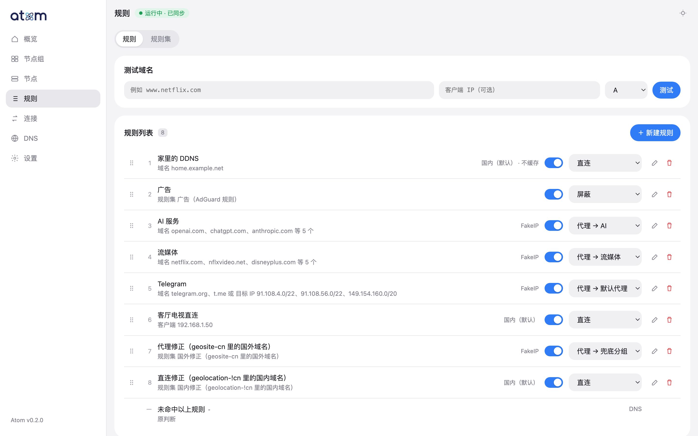

<p align="center">
  <picture>
    <source media="(prefers-color-scheme: dark)" srcset="docs/assets/logo/atom-wordmark-dark.svg">
    
  </picture>
</p>

<p align="center">
  A split-routing gateway that runs DNS and the proxy on one Linux box: DNS decides the exit, the proxy only carries it out.
</p>

<p align="center">
  <a href="https://github.com/jasonxtt/atom/releases/latest"></a>
  <a href="LICENSE"></a>
  
  
</p>

<p align="center">
  <a href="README.md">简体中文</a> · English
</p>



> The panel and the detailed guides are in Chinese. This page is a summary.

## Why atom

In the usual DNS-plus-proxy setup, DNS decides domestic or foreign once, then the proxy core decides again with its own rules. Two rule sets to maintain, and they disagree. atom decides in one place:

- **One decision point.** For every domain, the DNS rule table decides: direct, a node group, or block. The proxy core follows that decision and never routes a second time.
- **One rule table.** Ordered, first match wins, drag to reorder. Domains no rule matches fall through to the built-in domestic/foreign split (geosite, geoip and learned domains).
- **One panel.** Nodes, groups, rules, connections, DNS upstreams and system settings in one web UI, no YAML.
- **Two proxy cores.** Switch between sing-box and mihomo in the panel. With mihomo you also get provider subscriptions and fallback / load-balance groups.
- **Proxied names never reach the domestic resolver.** A domain that hits a proxy rule gets a FakeIP right away and is resolved remotely by the node.
- **Install, upgrade and roll back from the browser.** One command starts a web wizard. Upgrades are signed, checked, and restored automatically when the new version fails its self-test.

## How it works

```text
client DNS     ──> atomdns: rule table ─┬─ direct → domestic DNS → real IP
                                        ├─ proxy  → group X → FakeIP, tells the core "this name goes to X"
                                        ├─ block  → empty answer
                                        └─ no match → domestic/foreign split → real IP or FakeIP (Final group)

client traffic ──> nft (TCP redirect / UDP TProxy) ──> sing-box or mihomo ──> node / direct
```

Each FakeIP answer carries the chosen group to the proxy core in an EDNS0 option. When the connection arrives, the core maps the FakeIP back to the name and uses that binding directly, without running its own route rules. See the [core patch](docs/singbox-fakeip-outbound.md) (Chinese).

## Quick start

A Debian 12+, Ubuntu 22.04+ or Alpine 3.19+ machine (x86_64 or aarch64, bare metal or VM; Docker and LXC containers are not supported), as root:

```bash
curl -fsSL https://github.com/jasonxtt/atom/releases/latest/download/install.sh | sudo bash
```

The script downloads and verifies the package, then starts a web wizard and prints its address and a 6-digit code. Open it in a browser and pick the topology, the proxy core, DNS and nodes. When the install finishes, the wizard takes you to the panel. On Alpine, run `apk add bash curl` first and use `bash` instead of `sudo bash`.

Then, on your **main router**:

1. Route the FakeIP range (default `28.0.0.0/8`) and any ranges you want proxied to atom's LAN IP.
2. Set the clients' DNS server to atom's LAN IP, usually in the router's DHCP settings.

## Repositories

| Repository | Contents |
|---|---|
| [jasonxtt/atom](https://github.com/jasonxtt/atom) (this one) | Installer, packaging, docs; pins the three below as submodules |
| [jasonxtt/atom-core](https://github.com/jasonxtt/atom-core) (`atomdns/`) | atom branch of AtomDNS: DNS, rule table, nodes and groups, core config, management API, web UI |
| [jasonxtt/sing-box](https://github.com/jasonxtt/sing-box) (`sing-box/`) | sing-box v1.14.4 with the FakeIP outbound binding patch |
| [jasonxtt/mihomo](https://github.com/jasonxtt/mihomo) (`mihomo/`) | mihomo v1.19.34 with the same patch |

Building from source: see [docs/development.md](docs/development.md) (Chinese).

## License

[GPL-3.0](LICENSE). The atom-core, sing-box and mihomo forks are derivative works of AtomDNS (MosDNS), sing-box and mihomo, released under GPL-3.0 with their original copyright notices kept.
