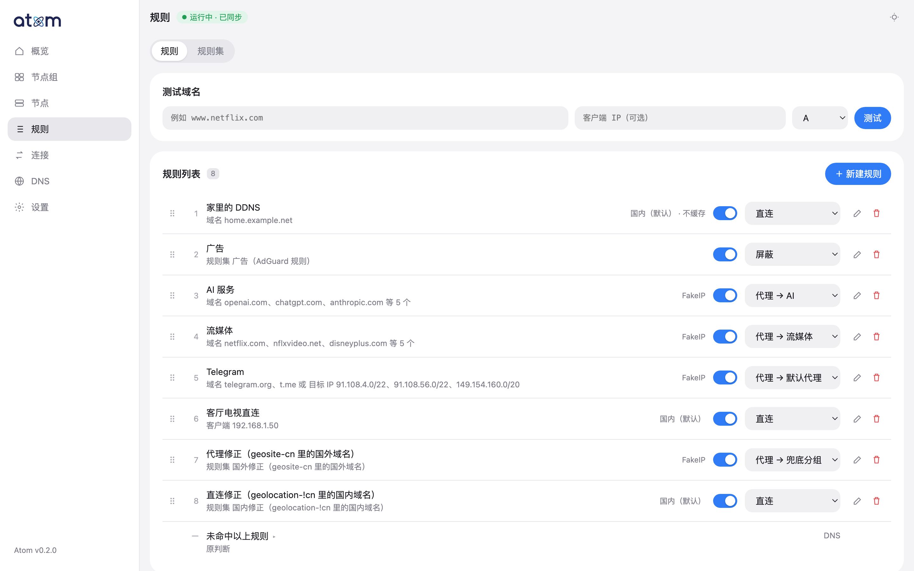
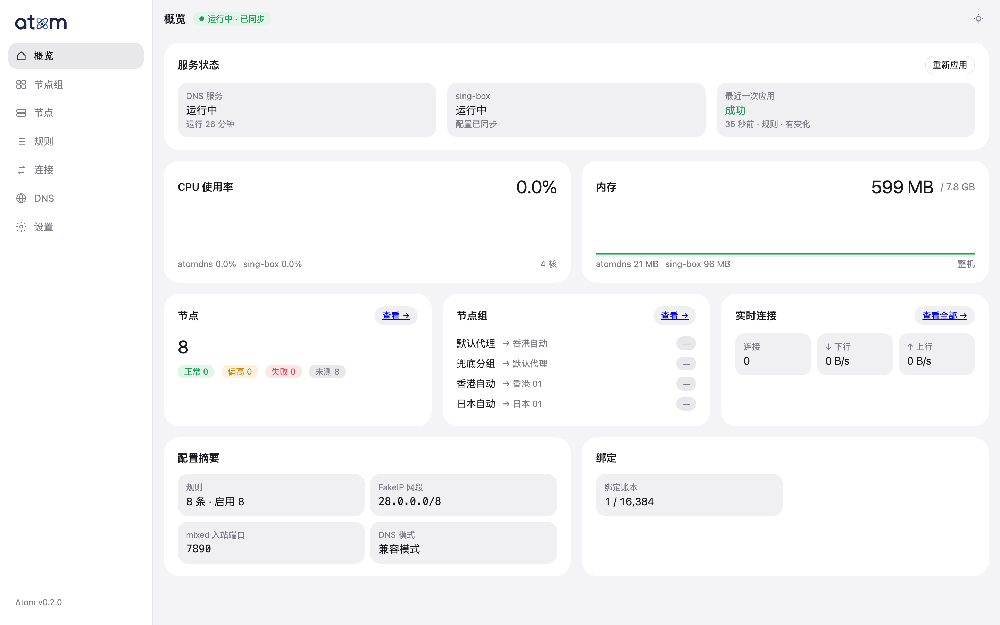
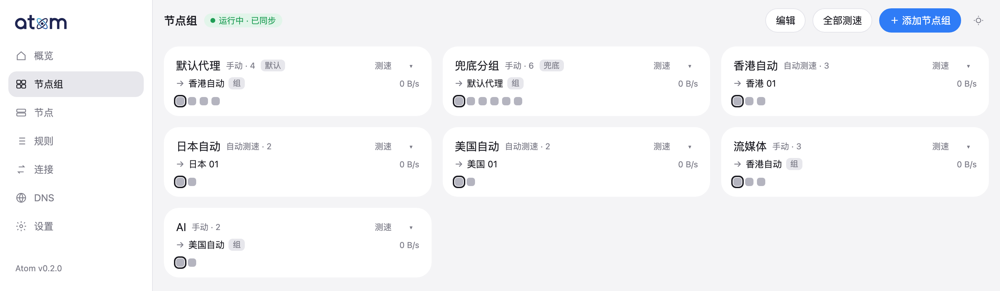

<p align="center">
  <picture>
    <source media="(prefers-color-scheme: dark)" srcset="docs/assets/logo/atom-wordmark-dark.svg">
    
  </picture>
</p>

<p align="center">
  一台 Linux 机器同时跑 DNS 和代理的分流网关：DNS 决定出口，代理只管执行。
</p>

<p align="center">
  <a href="https://github.com/jasonxtt/atom/releases/latest"></a>
  <a href="LICENSE"></a>
  
  
</p>

<p align="center">
  简体中文 · <a href="README.en.md">English</a>
</p>



## 为什么用 atom

常见的 DNS 加代理方案里，DNS 判断一次国内还是国外，代理核心再按自己的规则判断一次，两套规则要分别维护，还经常互相打架。atom 只在 DNS 这一处做决定：

- **一个决策点**：每个域名走直连、走哪个节点组，还是屏蔽，都由 DNS 查规则表决定。代理核心按 DNS 的决定执行，不再自己判断。
- **一套规则**：规则表从上往下匹配，第一条命中的生效，可以拖动排序。没有命中的域名交给内置的国内外判断（geosite、geoip 和域名学习）。
- **一个面板**：节点、节点组、规则、连接、DNS 上游和系统设置都在同一个网页里，不用再去改 YAML。
- **两种代理内核**：sing-box 和 mihomo 可以在面板里切换。用 mihomo 时支持机场订阅，以及 fallback、load-balance 这两种节点组。
- **走代理的域名不经过国内 DNS**：命中代理规则的域名直接返回 FakeIP，由节点在远端解析，查询记录不会留在国内 DNS 上。
- **装、升、退都在网页里完成**：一条命令启动网页向导。之后的升级、改网络、回滚都在面板里做，升级包要验证签名，失败会自动恢复。

## 怎么工作

```text
客户端 DNS ──> atomdns 查规则表
                 ├─ 直连   → 国内 DNS → 真实 IP
                 ├─ 代理   → 组 X → FakeIP，并告诉内核走组 X
                 ├─ 屏蔽   → 空应答
                 └─ 没命中 → 国内外判断 → 真实 IP，或 FakeIP 走兜底分组

客户端流量 ──> nft 透明代理 ──> sing-box 或 mihomo ──> 节点 / 直连
```

atomdns 每次返回 FakeIP 时，都会通过 EDNS0 选项把这个域名该走哪个组告诉代理内核。连接到达时，内核由 FakeIP 还原出域名，直接按这个绑定出站，不会再过一遍自己的路由规则。细节见 [设计文档](docs/design.md) 和 [内核补丁](docs/singbox-fakeip-outbound.md)。

## 快速开始

需要一台 Debian 12+、Ubuntu 22.04+ 或 Alpine 3.19+ 的机器（x86_64 或 aarch64，物理机或虚拟机），用 root 运行：

```bash
curl -fsSL https://github.com/jasonxtt/atom/releases/latest/download/install.sh | sudo bash
```

脚本下载安装包并校验后，会启动一个网页向导，并在终端打印网址和 6 位安装码。在浏览器里打开网址，依次选择网络拓扑、代理内核，设置 DNS 和节点，装完会自动跳到面板。GitHub 访问不了时，脚本会自动换用加速地址下载。Alpine 上先运行 `apk add bash curl`，再把命令里的 `sudo bash` 换成 `bash`。

装完后还要在**主路由**上做两件事：

1. 把 FakeIP 网段（默认 `198.18.0.0/15`）和要走代理的网段路由到 atom 的 LAN IP。
2. 把客户端的 DNS 设为 atom 的 LAN IP，一般在 DHCP 设置里改。

单网卡旁路由和双网卡网关这两种接法，详见 [安装和接入](docs/guide/install.md)。

### Docker 和 RouterOS

也可以用容器部署单网卡旁路由：Docker（macvlan）用镜像 [`jasonxtt/atom`](https://hub.docker.com/r/jasonxtt/atom)，RouterOS 用 Release 里的 `atom-<版本>-container-{amd64,arm64}.tar`。启动后看容器日志里的向导地址和安装码，其余同上。compose 示例和 RouterOS 的接法见 [容器版](docs/container.md) 第 7 节。

## 面板

| 概览 | 节点组 |
|---|---|
|  |  |

## 文档

| 文档 | 内容 |
|---|---|
| [安装和接入](docs/guide/install.md) | 系统要求、安装向导、两种拓扑、主路由设置 |
| [规则](docs/guide/rules.md) | 规则表怎么匹配、条件和动作、规则集、改动后多久生效 |
| [DNS 和域名学习](docs/guide/dns.md) | 一次查询怎么走、域名学习和有效期、定期刷新、缓存、上游组、统计 |
| [节点、节点组和订阅](docs/guide/proxy.md) | 导入节点、各类节点组、兜底分组、mihomo 订阅、切换内核 |
| [容器版](docs/container.md) | Docker、RouterOS 部署，升级和限制 |
| [升级和维护](docs/guide/maintenance.md) | 面板升级、修改网络、卸载、应急恢复、文件位置 |
| [常见问题](docs/guide/faq.md) | 部分设备不走代理、改了规则没生效、DoH 和 IPv6 |
| [开发和构建](docs/development.md) | 仓库结构、从源码构建、发布流程、设计文档 |

## 仓库组成

| 仓库 | 内容 |
|---|---|
| [jasonxtt/atom](https://github.com/jasonxtt/atom)（本仓库） | 安装器、打包脚本、文档；用子模块固定下面三个仓库的配套版本 |
| [jasonxtt/atom-core](https://github.com/jasonxtt/atom-core)（`atomdns/`） | AtomDNS 的 atom 分支：DNS、规则表、节点和节点组、生成内核配置、管理 API、WebUI |
| [jasonxtt/sing-box](https://github.com/jasonxtt/sing-box)（`sing-box/`） | sing-box v1.14.4，加上 FakeIP 出口绑定补丁 |
| [jasonxtt/mihomo](https://github.com/jasonxtt/mihomo)（`mihomo/`） | mihomo v1.19.34，加上同一套 FakeIP 出口绑定补丁 |

## 致谢

atom 建立在这些项目之上：[AtomDNS](https://github.com/jasonxtt/atomdns)、[MosDNS](https://github.com/IrineSistiana/mosdns)（以及 [yyysuo/mosdns](https://github.com/yyysuo/mosdns) 的分流方案）、[sing-box](https://github.com/SagerNet/sing-box)、[mihomo](https://github.com/MetaCubeX/mihomo)、[meta-rules-dat](https://github.com/MetaCubeX/meta-rules-dat)、[sing-geosite](https://github.com/nekolsd/sing-geosite)。

## 许可证

[GPL-3.0](LICENSE)。atom-core、sing-box 和 mihomo 的分支分别是 AtomDNS（MosDNS）、sing-box 和 mihomo 的衍生作品，同样以 GPL-3.0 发布，并保留各自原有的版权声明。
